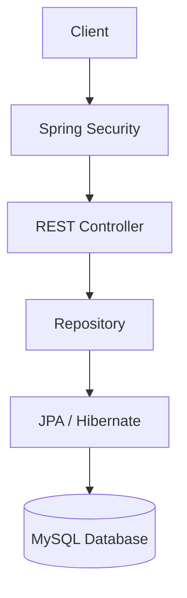
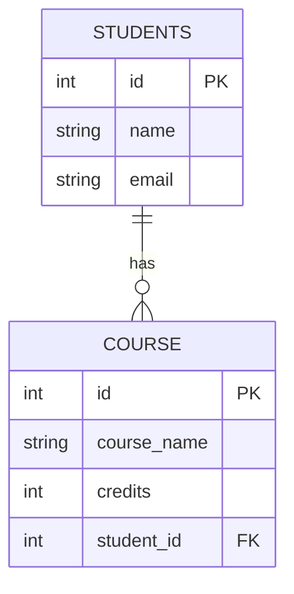

# Enterprise Java Lab – Student Management System

## Project Overview

This project is developed as part of the Enterprise Java Lab coursework. It is a RESTful Student Management System built using Spring Boot and MySQL.

The project was developed through nine lab experiments covering REST APIs, CRUD operations, database integration, entity relationships, validation, testing, and authentication.

## Technologies Used

- Java (JDK 21)
- Spring Boot
- Spring Data JPA and Hibernate
- MySQL
- Maven
- Spring Security
- JUnit and MockMvc
- IntelliJ IDEA
- cURL

## Lab Experiments

### Experiment 1: Environment Setup

- Installed and configured IntelliJ IDEA and Java.
- Created a Spring Boot project using Maven.
- Understood the project structure and dependencies.

### Experiment 2: Introduction to Spring Boot

- Created the `HelloController` class.
- Implemented the first REST API using `@RestController` and `@GetMapping`.
- Tested the `/hello` endpoint.

### Experiment 3: CRUD Operations

- Created the Student model with ID, name, and email.
- Used ArrayList for in-memory data storage.
- Implemented GET, POST, PUT, and DELETE operations.
- Learned about `@RequestBody`, `@PathVariable`, and `ResponseEntity`.

### Experiment 4: Database Integration

- Created the `studentdb` database in MySQL.
- Connected Spring Boot with MySQL using Spring Data JPA.
- Created the Student entity and StudentRepository.
- Replaced in-memory storage with persistent database storage.

### Experiment 5: Derived Queries, Pagination and Sorting

- Implemented student search by name, keyword, and email.
- Used derived query methods without writing SQL manually.
- Implemented pagination using `Pageable`.
- Implemented alphabetical sorting using `Sort`.

### Experiment 6: Entity Relationships

- Created the Course entity and CourseRepository.
- Implemented One-to-Many and Many-to-One relationships.
- Assigned multiple courses to a student.
- Used Jackson annotations to prevent infinite JSON recursion.

### Experiment 7: Validation and Exception Handling

- Implemented input validation using `@NotBlank`, `@Email`, and `@Valid`.
- Created a GlobalExceptionHandler using `@RestControllerAdvice`.
- Returned meaningful error messages with HTTP 400 responses.

### Experiment 8: REST API Testing

- Tested CRUD operations using cURL.
- Introduced automated testing using JUnit and MockMvc.
- Verified HTTP status codes and validation responses.
- Implemented automatic student ID generation using `AUTO_INCREMENT`.

### Experiment 9: Spring Security

- Added Spring Security to the application.
- Configured HTTP Basic Authentication using SecurityFilterChain.
- Made `/hello` publicly accessible.
- Protected student and course endpoints.
- Tested requests with valid and invalid credentials.

## Project Architecture



## Database Design

The application uses two tables: `students` and `course`.



One student can have multiple course records. The relationship is maintained through the `student_id` foreign key.

## REST API Endpoints

| Method | Endpoint | Description |
|--------|----------|-------------|
| GET | /hello | Public greeting endpoint |
| GET | /students | Get all students |
| GET | /students/{id} | Get student by ID |
| POST | /students | Create a student |
| PUT | /students/{id} | Update a student |
| DELETE | /students/{id} | Delete a student |
| GET | /students/search/name/{name} | Search by name |
| GET | /students/search/name/contains/{keyword} | Search by keyword |
| GET | /students/search/email/{email} | Search by email |
| GET | /students/page?page=0&size=2 | Pagination |
| GET | /students/sort/name | Sort students |
| GET | /courses | Get all courses |
| POST | /students/{studentId}/courses | Assign a course |

All listed endpoints except `/hello` require authentication.

## How to Run the Project

### 1. Prerequisites

- Java JDK 21
- MySQL Server
- Maven
- IntelliJ IDEA

### 2. Database Setup

Create a database in MySQL:

```sql
CREATE DATABASE studentdb;
```

### 3. Application Configuration

Configure `src/main/resources/application.properties`:

```properties
server.port=8081

spring.datasource.url=jdbc:mysql://localhost:3306/studentdb
spring.datasource.username=root
spring.datasource.password=${DB_PASSWORD}

spring.jpa.hibernate.ddl-auto=update
spring.jpa.show-sql=true

spring.security.user.name=admin
spring.security.user.password=${APP_PASSWORD}
```

Set the `DB_PASSWORD` and `APP_PASSWORD` environment variables in the IntelliJ Run Configuration before starting the application.

### 4. Run the Application

Open the project in IntelliJ IDEA, load the Maven dependencies, and run `StudentManagementApplication.java`.

Alternatively, use Maven:

```bash
mvn spring-boot:run
```

The application runs at:

http://localhost:8081

## API Testing

Test the public endpoint:

```bash
curl -i http://localhost:8081/hello
```

Retrieve students using authentication:

```bash
curl -i -u admin http://localhost:8081/students
```

Create a new student:

```bash
curl -i -u admin -X POST http://localhost:8081/students \
-H "Content-Type: application/json" \
-d '{"name":"Rahul","email":"rahul@example.com"}'
```

Run automated tests:

```bash
mvn test
```

The earlier automated tests for protected endpoints need authentication after the Spring Security configuration.

## Key Concepts and Learning Outcomes

Through these experiments, I learned:

- Spring Boot application development.
- REST APIs and HTTP methods.
- CRUD operations and HTTP status codes.
- Dependency Injection and Maven dependency management.
- Database connectivity using JPA and Hibernate.
- Entity relationships and foreign keys.
- Derived queries, pagination, and sorting.
- Input validation and exception handling.
- Manual and automated API testing.
- Authentication using Spring Security.

## Conclusion

This project helped me understand how a basic Java application can be developed into a database-driven REST API with validation, testing, and authentication.

## Author

**Vishwas Bishnoi**

B.Tech – Computer Science and Engineering  
IIIT Sonepat